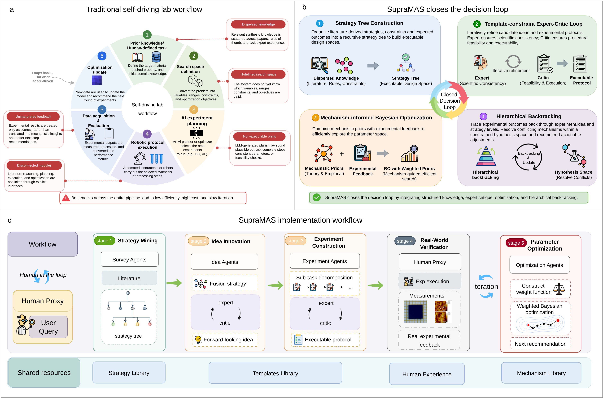
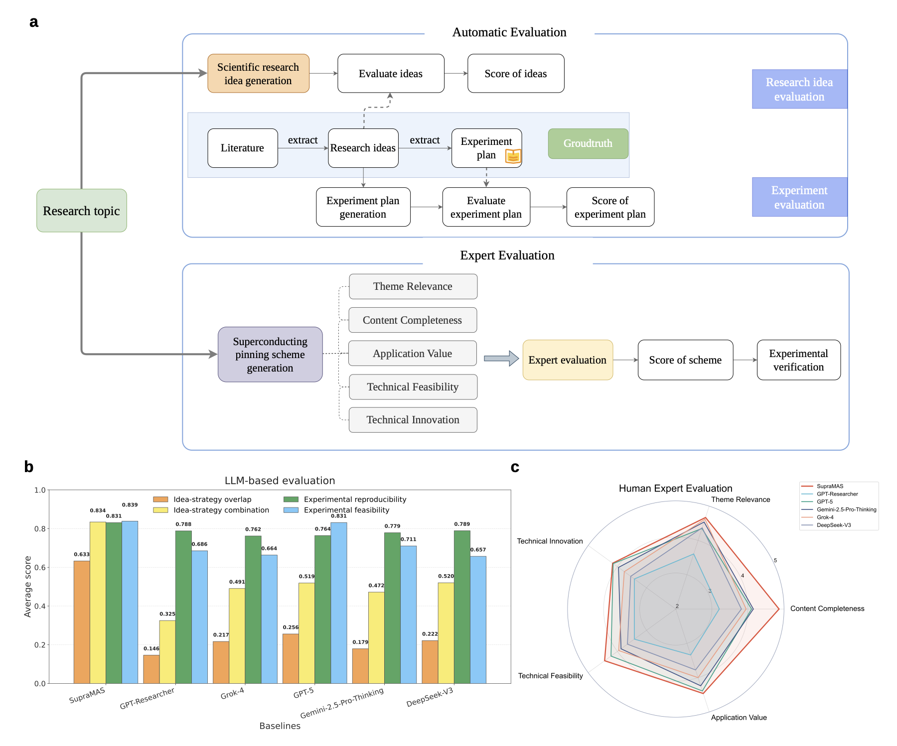
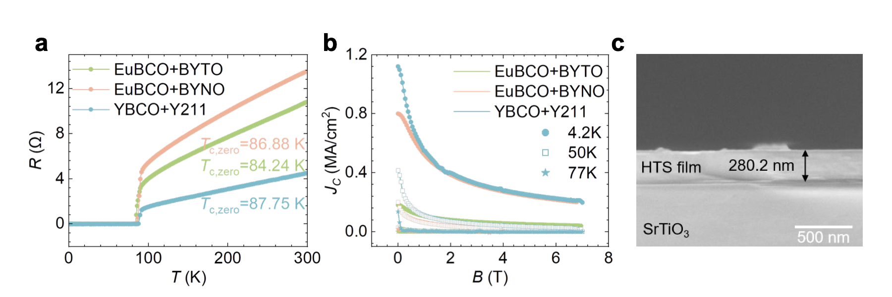
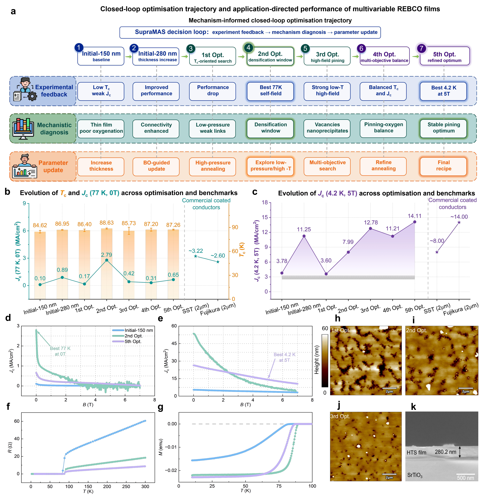
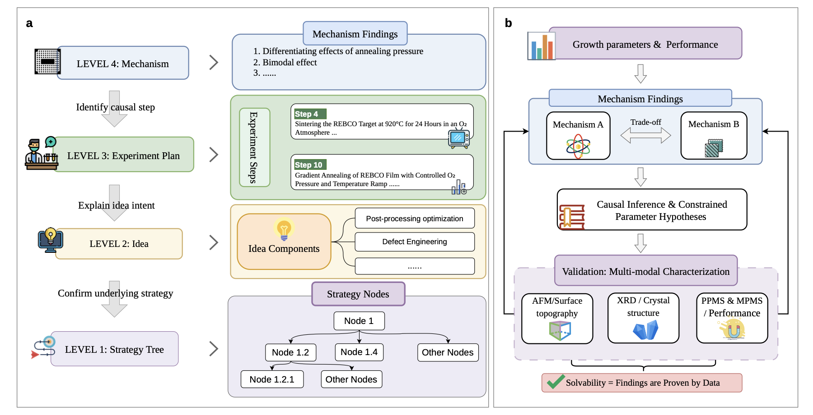

<div align="center">
  

  <h1>SupraMAS</h1>

  <p>
    <strong>Mechanism-informed multi-agent research framework for literature-grounded,
    executable, and closed-loop design of high-temperature superconducting coated conductors.</strong>
  </p>

  <p>
    <a href="https://github.com/OpenMatSci/SupraMAS"></a>
    <a href="https://cmpdc.iphy.ac.cn/supramas"></a>
    <a href="https://github.com/OpenMatSci/SupraMAS/blob/main/LICENSE"></a>
    
    <a href="https://doi.org/10.57967/hf/8671"></a>
  </p>
</div>

## Overview

SupraMAS, short for **Supra Multi-Agent Scientist**, is the public reviewer-facing framework release for the manuscript:

> Mechanism-informed closed-loop on-demand design of high-temperature superconducting coated conductors

The framework converts literature-derived mechanisms, empirical rules, and process constraints into auditable research ideas, executable experimental protocols, and mechanism-informed optimization decisions for strongly constrained materials synthesis. This public repository exposes the **overall software architecture, module interfaces, benchmark artifacts, examples, and data-availability package** so reviewers can inspect the research workflow and reproduce reported data checks.

Detailed production agent prompts, retrieval heuristics, optimization internals, private service integrations, local credentials, and deployment code are intentionally excluded. The `src/supramas` package is therefore a compact framework skeleton rather than the full private implementation.

## Platform Access

A hosted SupraMAS platform is available at:

<https://cmpdc.iphy.ac.cn/supramas>

The platform provides an interactive entry point for inspecting and using the SupraMAS workflow, while this repository provides the reviewer-facing framework skeleton, benchmark artifacts, examples, and data-availability package.

## Key Figures And Results

The figures below are README-friendly renders of the main manuscript figures. Numerical source data, benchmark outputs, and expert-evaluation records are released under [`data_availability/`](data_availability/).

### Workflow Overview

<p align="center">
  
</p>

SupraMAS links five stages into a closed-loop research workflow: Strategy Mining, Idea Innovation, Experiment Construction, Real-World Verification, and Parameter Optimization. The public code keeps this module boundary visible while omitting private production prompts, retrieval heuristics, and service integrations.

### Benchmark Snapshot

<p align="center">
  
</p>

The benchmark uses a strict time split: systems are restricted to literature available before **January 1, 2025**, then evaluated against ground-truth ideas and protocols from studies first publicly available on or after **January 1, 2025**.

| System | Idea overlap | Idea combination | Protocol reproducibility | Protocol feasibility | Expert overall |
| --- | ---: | ---: | ---: | ---: | ---: |
| SupraMAS | 0.633 | 0.834 | 0.831 | 0.839 | 4.519 |
| GPT-5 | 0.256 | 0.519 | 0.764 | 0.831 | 4.240 |
| Gemini-2.5-Pro-Thinking | 0.179 | 0.472 | 0.779 | 0.711 | 4.153 |
| Grok-4 | 0.217 | 0.491 | 0.762 | 0.664 | 4.058 |
| DeepSeek-V3 | 0.222 | 0.520 | 0.789 | 0.657 | 3.833 |
| GPT-Researcher | 0.160 | 0.467 | 0.788 | 0.686 | 3.398 |

Sources: [`data_availability/benchmark_results/benchmark_summary.csv`](data_availability/benchmark_results/benchmark_summary.csv) and [`data_availability/expert_evaluation/human_expert_mean_scores.csv`](data_availability/expert_evaluation/human_expert_mean_scores.csv).

### Laboratory Validation

<p align="center">
  
</p>

Single artificial pinning-system protocols generated by SupraMAS were translated into laboratory procedures for EuBCO + BYTO, EuBCO + BYNO, and YBCO + Y211 films. All three films were successfully grown on STO substrates and showed zero-resistance superconducting transitions above 84 K.

<p align="center">
  
</p>

For the multivariable (Y,Yb,Sm)BCO + BZO + BYNO system, SupraMAS-guided optimization identified distinct application regimes: a 77 K self-field regime with `Tc = 89.4 K` and `Jc = 2.79 MA cm^-2`, and a low-temperature/high-field regime with `Jc = 14.11 MA cm^-2` at 4.2 K and 5 T.

| Sample | Tc (K) | Jc 4.2 K, 5 T (MA cm^-2) | Jc 20 K, 5 T (MA cm^-2) | Jc 77 K, 0 T (MA cm^-2) |
| --- | ---: | ---: | ---: | ---: |
| SupraMAS-150 nm | 83.2 | 3.78 | 2.32 | 0.10 |
| SupraMAS-280 nm | 86.6 | 11.25 | 6.84 | 0.89 |
| 1st Optimization | 85.2 | 3.60 | 1.14 | 0.17 |
| 2nd Optimization | 89.4 | 7.99 | 3.79 | 2.79 |
| 3rd Optimization | 88.0 | 12.78 | 6.44 | 0.42 |
| 4th Optimization | 85.0 | 11.21 | 5.66 | 0.31 |
| 5th Optimization | 87.4 | 14.11 | 7.67 | 0.65 |

Source data are available in [`data_availability/source_data/figure_source_data/`](data_availability/source_data/figure_source_data/), with optimization records in [`data_availability/optimization_trajectory/`](data_availability/optimization_trajectory/).

### Interpretability

<p align="center">
  
</p>

The interpretability layer traces observed mechanisms back through experimental-plan components, idea components, and strategy-tree nodes, making the reasoning lineage inspectable without exposing private implementation internals.

## What This Public Skeleton Shows

- **Strategy mining** module boundaries and strategy-tree output shape.
- **Idea innovation** orchestration interface and expected artifact flow.
- **Experiment construction** proposal/evaluator boundaries and protocol artifact shape.
- **Real-world verification** records through released case studies and data files.
- **Mechanism-informed Bayesian optimization** interface and reported optimization trajectory.
- **Interpretability tracing** input/output records and traceback artifact shape.

## Table Of Contents

- [Installation](#installation)
- [Platform Access](#platform-access)
- [Key Figures And Results](#key-figures-and-results)
- [Quick Start](#quick-start)
- [Configuration](#configuration)
- [Repository Layout](#repository-layout)
- [Architecture](#architecture)
- [Benchmark](#benchmark)
- [Data Availability](#data-availability)
- [Verification](#verification)
- [Security And Release Hygiene](#security-and-release-hygiene)
- [Citation](#citation)
- [License](#license)

## Installation

SupraMAS requires **Python 3.10 or newer**.

```bash
git clone https://github.com/OpenMatSci/SupraMAS.git
cd SupraMAS

python -m venv .venv
source .venv/bin/activate
python -m pip install --upgrade pip
pip install -e .
```

For local development or structural checks, the editable install is enough for the shipped tests and CLI smoke tests. The public package is an interface skeleton; full private end-to-end research execution is not included.

## Quick Start

Inspect the framework skeleton without making model calls:

```bash
supramas --help

supramas \
  --topic "Improve the bearing current capacity of superconducting strips through pinning" \
  --config configs/supramas.example.yaml \
  --dry-run
```

Run the bundled quickstart topic:

```bash
supramas \
  --topic "$(python -c 'import json; print(json.load(open("examples/quickstart/topic.json"))["topic"])')" \
  --config configs/supramas.example.yaml \
  --dry-run
```

Optionally write a framework-overview artifact:

```bash
supramas \
  --topic "Design REBCO coated conductors with enhanced flux pinning" \
  --config configs/supramas.example.yaml \
  --output-dir outputs \
  --write-overview
```

The command writes `outputs/framework_overview.json`. It does not run private production agents.

## Configuration

Start from the public example configuration:

```bash
cp configs/supramas.example.yaml configs/supramas.local.yaml
```

Then fill values locally if you are adapting the skeleton to your own implementation. Do not commit `configs/supramas.local.yaml`, `.env` files, API keys, model gateway URLs, Milvus credentials, or other secrets.

Important runtime services:

| Service | Purpose | Required for private/full run |
| --- | --- | --- |
| OpenAI-compatible LLM endpoint | Agent reasoning, self-revision, and protocol generation | Yes |
| Embedding endpoint | Literature and knowledge-library retrieval | Yes |
| Milvus | Vector search over papers, strategies, and templates | Yes |
| Semantic Scholar / Google Scholar compatible search | Literature discovery | Recommended |
| GROBID | PDF parsing for local literature workflows | Optional |
| Translation credentials | Cross-language literature processing | Optional |

Most values can be supplied through environment variables or YAML. See [`configs/supramas.example.yaml`](configs/supramas.example.yaml) and [`docs/configuration.md`](docs/configuration.md).

## Repository Layout

```text
src/supramas/                    Public framework skeleton
  strategy_tree/                 Literature-grounded strategy-tree construction
  protocol_optimizer/            Protocol proposal, retrieval, and evaluator modules
  parameter_optimization/        Mechanism-informed Bayesian optimization utilities
  explainability/                Mechanism, protocol, idea, and strategy traceback
  prompts/                       Prompt-family catalog placeholders
  utils/                         Lightweight artifact helpers

knowledge_libraries/             Mechanism, strategy, and template libraries
benchmark/                       Benchmark inputs, labels, evaluators, adapters, and results
data_availability/               Public manuscript data-availability package
examples/                        Quickstart topic and released case-study records
configs/                         Example runtime and benchmark configuration files
scripts/                         Reproduction, checksum, and manifest utilities
docs/                            Architecture, benchmark, configuration, data, and security notes
tests/                           Lightweight structural tests
```

## Architecture

SupraMAS is organized as a five-stage, human-in-the-loop research workflow:

1. **Strategy Mining**: recursively expands a strategy tree from literature-derived control dimensions, limitations, and expected outcomes.
2. **Idea Innovation**: combines selected strategy branches into mechanism-aware research hypotheses.
3. **Experiment Construction**: decomposes hypotheses into executable experimental protocols with expert-critic revision.
4. **Real-World Verification**: records experimental execution and measurements, including structural and superconducting-property feedback.
5. **Parameter Optimization**: integrates mechanistic priors and experimental data into a closed-loop optimization process.

The workflow is connected by shared memory and three external knowledge resources: a Knowledge Library, a Policy Library, and a Templates Library. For more detail, see [`docs/architecture.md`](docs/architecture.md).

## Benchmark

The public benchmark evaluates scientific-planning quality across two tracks:

- **Idea foresight**: strategy overlap and strategy-combination alignment against post-cutoff superconductivity studies.
- **Protocol evaluation**: experimental reproducibility and standalone feasibility of generated protocols.

Reported benchmark inputs, labels, and manuscript results are included under [`benchmark/`](benchmark/) and [`data_availability/benchmark_results/`](data_availability/benchmark_results/).

Run lightweight validation and summary commands:

```bash
python scripts/reproduce_benchmark.py --validate
python scripts/reproduce_benchmark.py --summary-only
python -m benchmark.evaluation.eval_idea --help
python -m benchmark.evaluation.eval_protocol --help
```

Full LLM-based re-evaluation requires local model credentials and may incur model-service costs. See [`benchmark/README.md`](benchmark/README.md) and [`docs/benchmark.md`](docs/benchmark.md).

## Data Availability

The manuscript data package is available in two forms:

- Local mirror in this repository: [`data_availability/`](data_availability/)
- Public data repository: <https://doi.org/10.57967/hf/8671>

The package includes source data for manuscript figures and tables, growth and annealing parameters, superconducting-property summaries, optimization trajectories, benchmark labels/results, expert-evaluation files, generated protocols, interpretability records, metadata, manifests, and checksums.

Verify the local data package:

```bash
python scripts/verify_checksums.py data_availability/metadata/checksums_sha256.csv
```

See [`data_availability/README.md`](data_availability/README.md) and [`docs/data_availability.md`](docs/data_availability.md).

## Verification

Recommended checks before opening a pull request or publishing a release:

```bash
python -m compileall src benchmark scripts
python scripts/reproduce_benchmark.py --validate
python scripts/verify_checksums.py data_availability/metadata/checksums_sha256.csv
```

If `pytest` is installed locally:

```bash
python -m pytest
```

## Security And Release Hygiene

This repository is a cleaned public framework/data release. It should not contain real API keys, private model gateways, local `.env` files, private Milvus credentials, private PDF corpora, full private implementation internals, or old Git history.

Before publishing a new release, scan for accidental secrets:

```bash
rg -n "sk-|AKLT|api[_-]?key|password|secret|token" .
```

Expected matches should be limited to placeholder keys, environment-variable readers, documentation, and non-sensitive benchmark text. See [`docs/security.md`](docs/security.md).

## Contributing

Contributions are welcome through issues and pull requests. Please keep changes focused, include a short description of the scientific or engineering motivation, and run the verification commands above before submitting.

For substantial changes, open an issue first so maintainers can discuss scope, data requirements, and reproducibility expectations.

## Citation

If you use SupraMAS, the released benchmark, or the associated data package, please cite the repository and the accompanying manuscript. Machine-readable citation metadata is provided in [`CITATION.cff`](CITATION.cff).

Public code release:

```text
https://github.com/OpenMatSci/SupraMAS/tree/main
```

Public data repository:

```text
https://doi.org/10.57967/hf/8671
```

## License

SupraMAS is released under the [MIT License](LICENSE).
